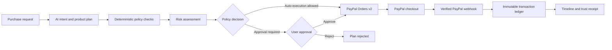

# PayPilot

**Governed AI procurement with PayPal Sandbox settlement.**

PayPilot turns a purchase request into a reviewable plan. AI can interpret the request and compare catalog options, while deterministic server-side policy and risk checks decide whether that plan is allowed. When policy requires it, a person approves the plan before checkout. PayPal confirms payment, and a verified webhook records settlement in the audit ledger.

> **Hackathon demo:** [Open PayPilot](https://paypilot-web-4jd8.onrender.com/) · [API health](https://paypilot-api-85n1.onrender.com/health)
>
> Payments are configured for **PayPal Sandbox**. Use Sandbox buyer credentials at checkout. The app is a hackathon prototype, not a financial institution or a production system for moving real money.


## Submission demo

1. Open the [deployed app](https://paypilot-web-4jd8.onrender.com/) and choose **Try the demo**.
2. On the dashboard, submit: `I need a developer monitor under $250. Prioritize text clarity and value.`  
3. Review the recommended item, alternatives, policy checks, and risk assessment.
4. The demo policy uses **Ask Every Time**, so approve the plan and try checkout with a PayPal Sandbox buyer account. Complete the PayPal checkout to authorize the test payment.
5. Inspect the plan, activity timeline, payment record, or trust receipt to follow the decision and settlement evidence.

The seeded demo login is `demo@paypilot.dev` / `Password123!`. The **Try the demo** button signs into this account automatically. These public demo credentials are for the shared hackathon environment only; do not reuse them for a private deployment.

## Why PayPilot

AI agents are good at interpreting a request and comparing products. They should not decide by themselves whether a transaction can be funded. PayPilot separates those responsibilities:



The model proposes and explains. Server code enforces policy, validates catalog IDs and amounts, checks state transitions, and controls payment actions.

## Product capabilities

- **Natural-language procurement planning:** Extracts category, budget, quantity, priorities, and use case from a purchase request.
- **Verified product recommendations:** Searches the seeded catalog, ranks candidate items, and explains alternatives and trade-offs.
- **Budget-aware replanning:** Proposes an in-budget substitute when the preferred item exceeds a spending ceiling.
- **Deterministic policy guard:** Enforces transaction, daily, and monthly limits; allowed and blocked categories; autonomy settings; and explicit approval rules.
- **Behavioral risk assessment:** Scores purchase size, spending velocity, category, and other risk signals before approval.
- **Human approval:** Presents policy results and risk details before creating a PayPal order.
- **Buyer and merchant negotiation:** Runs bounded negotiation rounds with server-only merchant floors and buyer ceilings.
- **PayPal Orders v2 and webhooks:** Creates idempotent orders, captures approved orders, verifies webhook signatures with PayPal, and deduplicates event IDs.
- **Audit timeline and trust receipts:** Tracks intent, planning, policy, approval, payment, and webhook events; provides export and receipt verification views.
- **Operational dashboards:** Includes a product store, AI assistant, plans, negotiation, policies, analytics, transactions, activity, and notifications.

## Account modes

AI behavior is selected server-side from the authenticated account. Users do not need to change environment flags when switching accounts.

| Account | Planning and negotiation behavior |
|---|---|
| `demo@paypilot.dev` | Uses built-in prompt fixtures and deterministic negotiation. It does not call the configured AI provider for those operations. |
| Any other signed-in account | Uses the configured live AI provider. A valid provider key and supported model are required. |

The fixtures cover the built-in demo prompts, including the developer monitor, sub-$200 monitor, USB-C hub and keyboard, and prompt-injection examples. For arbitrary requests, use a regular account with the live provider configured.

PayPal environment is configured separately from AI mode. The deployed app uses **Sandbox for all accounts**; signing in with a regular account does not switch PayPal to Live. `DEMO_MODE` controls server fallback behavior when PayPal credentials are absent; it does not identify demo users.

## Safety and trust model

- **The LLM cannot change policy.** Limits and category rules are loaded from PostgreSQL and evaluated in deterministic TypeScript.
- **Plan amounts are recomputed server-side.** The backend resolves recommended product IDs against the candidate catalog and uses database prices.
- **Approval follows policy.** The backend rechecks policy when creating an order and validates payment state transitions. Manual approval is required whenever the policy says so; auto-execution is available only when the user’s policy permits it.
- **Webhook confirmation is authoritative.** A client-side capture response does not settle the internal ledger. PayPilot verifies PayPal’s webhook signature before recording settlement.
- **Webhook replay is idempotent.** Event IDs are unique, preventing duplicate deliveries from duplicating ledger effects.
- **Merchant floors remain private.** The merchant reserve price is not sent to the browser or buyer agent.
- **Secrets stay server-side.** PayPal secrets, database URLs, Better Auth secrets, and AI provider keys belong only in the API environment.
- **Demo and production money movement are separated.** This repository’s Render configuration points to PayPal Sandbox. It is not approved for unattended production payments.

For additional detail, see [Security Model](docs/SECURITY.md), [Architecture](docs/ARCHITECTURE.md), [API reference](docs/API.md), and [PayPal setup](docs/PAYPAL_SETUP.md).

## Technology

| Area | Stack |
|---|---|
| Web app | Next.js 16 App Router, React 19, TypeScript, Tailwind CSS 4 |
| API | NestJS 12, TypeScript, Better Auth |
| Persistence | PostgreSQL, Prisma 7, `@prisma/adapter-pg` |
| Validation | Zod |
| Payments | PayPal JavaScript SDK, Orders v2 REST API, Webhooks |
| UI and data | Radix UI, Framer Motion, AG Grid, Recharts, TanStack Query |
| Deployment | Render web services and Render Postgres |

## Live deployment

| Service | URL | Health |
|---|---|---|
| Web | [paypilot-web-4jd8.onrender.com](https://paypilot-web-4jd8.onrender.com/) | Next.js app |
| API | [paypilot-api-85n1.onrender.com](https://paypilot-api-85n1.onrender.com/) | [`/health`](https://paypilot-api-85n1.onrender.com/health) · [`/health/config`](https://paypilot-api-85n1.onrender.com/health/config) |
| PayPal webhook | `https://paypilot-api-85n1.onrender.com/webhooks/paypal` | Registered on the PayPilot Sandbox REST app |

Render free instances can spin down when idle, so the first request after inactivity may take longer. The Render Blueprint is in [`render.yaml`](render.yaml). It defines the API and web services and expects an existing Render Postgres database named `paypilot-postgres` in the Ohio region.

### Render deployment settings

Keep the **Root Directory** empty for both services. The monorepo build needs the workspace root.

#### API service

| Setting | Value |
|---|---|
| Runtime | Node |
| Region | Ohio (same region as the database and web service) |
| Build command | `pnpm install --frozen-lockfile && pnpm --filter api exec prisma generate --schema prisma/schema.prisma && pnpm --filter api build` |
| Start command | `pnpm --filter api start:prod` |
| Health check | `/health` |

Set the API environment variables listed below. Render should provide the database’s **Internal Database URL** to the API service through the Blueprint reference. Set `WEB_ORIGIN` to the web service’s exact origin.

#### Web service

| Setting | Value |
|---|---|
| Runtime | Node |
| Region | Ohio |
| Build command | `pnpm install --frozen-lockfile && pnpm --filter web build` |
| Start command | `pnpm --filter web start` |

Set the three `NEXT_PUBLIC_*` values below on the web service. `NEXT_PUBLIC_API_URL` is used during the Next.js build, so redeploy after changing it.

### Environment variables

#### API service

| Variable | Required | Purpose / deployed value |
|---|---:|---|
| `DATABASE_URL` | Yes | Render Postgres Internal Database URL. For local remote migrations, use the External Database URL and `sslmode=require`. |
| `BETTER_AUTH_URL` | Yes | API origin, e.g. `https://paypilot-api-85n1.onrender.com` (no path). |
| `BETTER_AUTH_SECRET` | Yes | Private random secret of at least 32 characters. Render can generate this value. |
| `WEB_ORIGIN` | Yes | Frontend origin, e.g. `https://paypilot-web-4jd8.onrender.com` (no path or trailing slash). |
| `PORT` | Render-provided | Render assigns the listening port. Locally the API defaults to `4000`. |
| `LLM_PROVIDER` | Yes for regular accounts | Provider name; the current deployment uses `openrouter`. |
| `LLM_MODEL` | Yes for regular accounts | Provider model ID. The current Blueprint default is `nvidia/nemotron-3.5-super-vl:free`; use a model supported by your provider account. |
| `OPENROUTER_API_KEY` | Yes for regular accounts when using OpenRouter | Private provider key. Keep it only on the API service. |
| `GEMINI_API_KEY` / `ANTHROPIC_API_KEY` | Optional alternatives | The API also supports Gemini and Anthropic when selected with `LLM_PROVIDER`; the checked-in env templates use OpenRouter. |
| `LLM_FORCE_LIVE` | Recommended `true` for deployed regular-account AI | Requires live provider behavior for deployment-wide AI paths. The demo account’s planning requests still use fixtures. |
| `DEMO_MODE` | Set according to payment fallback policy | Controls mock PayPal fallback when credentials are absent and demo-only webhook behavior. It is not the per-account AI mode switch. |
| `PAYPAL_API_BASE_URL` | Yes for Sandbox checkout | `https://api-m.sandbox.paypal.com` |
| `PAYPAL_CLIENT_ID` | Yes for Sandbox checkout | Client ID from the same Sandbox REST app as the webhook. |
| `PAYPAL_CLIENT_SECRET` | Yes for Sandbox checkout | Secret from that same Sandbox REST app. Never put this on the web service. |
| `PAYPAL_WEBHOOK_ID` | Yes for webhook settlement | ID of the webhook registered to `https://paypilot-api-85n1.onrender.com/webhooks/paypal`. |
| `PAYPAL_CURRENCY` | Optional | Defaults to `USD`. |
| `ENABLE_WEBHOOK_SIMULATOR` | Local only | Set `true` only for local development. The simulator is disabled in production. |
| `DEMO_USER_PASSWORD` | Optional during seeding | Keep `Password123!` if you want the included **Try the demo** button to sign in successfully. |

Configure a live AI provider even if you plan to demo first: regular accounts intentionally use live AI. The demo account does not call the provider for supported fixture prompts.

#### Web service

| Variable | Value |
|---|---|
| `NEXT_PUBLIC_API_URL` | `https://paypilot-api-85n1.onrender.com` |
| `NEXT_PUBLIC_PAYPAL_CLIENT_ID` | Public client ID from the same PayPal Sandbox REST app. For local mock checkout, use `sb`. |
| `NEXT_PUBLIC_PAYPAL_CURRENCY` | `USD` |

Only browser-safe values belong in `NEXT_PUBLIC_*`. Do not add database credentials, `BETTER_AUTH_SECRET`, AI provider keys, or `PAYPAL_CLIENT_SECRET` to the web service.

### PayPal Sandbox webhook

In PayPal Developer Dashboard, select **Sandbox** and the REST app whose client ID and secret are configured on the API service. Register this listener URL:

```text
https://paypilot-api-85n1.onrender.com/webhooks/paypal
```

Subscribe to the events handled by the API:

- `CHECKOUT.ORDER.APPROVED`
- `PAYMENT.CAPTURE.PENDING`
- `PAYMENT.CAPTURE.COMPLETED`
- `PAYMENT.CAPTURE.DENIED`
- `PAYMENT.CAPTURE.DECLINED`
- `PAYMENT.CAPTURE.REVERSED`
- `PAYMENT.CAPTURE.REFUNDED`

Copy the generated **Webhook ID** into the API service’s `PAYPAL_WEBHOOK_ID`, then redeploy the API. The webhook ID must come from the same Sandbox REST app used by `PAYPAL_CLIENT_ID` and `PAYPAL_CLIENT_SECRET`.

### Initialize a deployed database

The Blueprint references (but does not create) the Render Postgres database named `paypilot-postgres`. Create it in Ohio first, or change the database name and region reference in `render.yaml` to match an existing database. The API build generates Prisma Client but does not apply migrations or seed data. After creating the database, set `DATABASE_URL` in your terminal to its **External Database URL**, then run these commands from the repository root:

```bash
pnpm db:migrate
pnpm db:seed
```

For an external Render connection, ensure TLS is required by appending `?sslmode=require` (or `&sslmode=require` if the URL already has query parameters). Keep the URL private and unset it after the commands. The seed operation adds 41 sample catalog products, the demo account, and demo policy; products and policy use upserts, so seeding can be repeated. Re-run `pnpm db:seed` after deploying catalog changes to add the new products to an existing database. These are sample catalog entries for the sandbox, not live merchant inventory.

If migrations have already completed, do not rerun them just to seed; run `pnpm db:seed` only. Never paste database URLs or passwords into GitHub, chat, or frontend environment variables.

## Local development

### Requirements

- Node.js 24 or newer
- pnpm 12.16.1 (declared in the root `package.json`)
- Docker with Docker Compose, or another PostgreSQL instance

### 1. Install dependencies and create environment files

```bash
corepack enable
corepack prepare pnpm@12.16.1 --activate
pnpm install
cp apps/api/.env.example apps/api/.env
cp apps/web/.env.example apps/web/.env.local
```

In `apps/api/.env`, set a private `BETTER_AUTH_SECRET` with at least 32 characters. For local fixture-only demo use, set:

```env
DEMO_MODE=true
LLM_FORCE_LIVE=false
```

This allows the API to start without a live AI provider key. The seeded demo account can use supported fixtures. Regular accounts still request live AI and need a configured provider key. For live PayPal Sandbox checkout, configure the matching Sandbox credentials, webhook ID, and browser client ID; without valid PayPal credentials, `DEMO_MODE=true` enables mock-payment fallback.

### 2. Start PostgreSQL, migrate, and seed

With Docker Compose:

```bash
pnpm db:up
pnpm db:migrate
pnpm db:seed
```

The local database URL in the API env template points to `localhost:5432`. If you use another database, update `DATABASE_URL` first.

### 3. Run both apps

```bash
pnpm dev
```

Open [http://localhost:3000](http://localhost:3000). The API runs on [http://localhost:4000](http://localhost:4000). The Next.js app rewrites `/api/*` requests to the API, keeping browser calls on the frontend origin.

You can also run the apps separately:

```bash
pnpm --filter api start:dev
pnpm --filter web dev
```

### Local webhook simulator

For local development only, set `ENABLE_WEBHOOK_SIMULATOR=true` and `DEMO_MODE=true` in the API environment. The dev endpoint is `POST /dev/webhooks/simulate`. It can exercise completed, denied, reversed, and duplicate event handling without exposing a local API to PayPal. It is unavailable when `NODE_ENV=production`.

## API overview

The API is a NestJS service. Authenticated app requests are sent through the Next.js `/api` rewrite; the webhook receiver is public and verifies PayPal signatures itself.

| Area | Routes |
|---|---|
| Health | `GET /health`, `GET /health/config` |
| Authentication | Better Auth routes under `/api/auth/*` |
| Catalog | `GET /products`, `GET /products/:id` |
| Planning | `POST /intents`, `POST /intents/stream`, `GET /intents`, `GET /plans`, `GET /plans/:id` |
| Plans | `POST /plans/:id/evaluate`, `/approve`, `/reject`, `/what-if`, `/cancel`; `PATCH /plans/:id/alternative` |
| Policies | `GET /policies/me`, `PUT /policies/me`, `POST /policies/simulate` |
| Negotiation | `POST /plans/:id/negotiate`, `GET /negotiations/:id` |
| Payments | `POST /plans/:id/pay`, `POST /payments/:id/capture`, `POST /payments/:id/cancel`, `GET /payments`, `GET /payments/:id` |
| Webhooks | `POST /webhooks/paypal`; local-only `POST /dev/webhooks/simulate` |
| Audit and analytics | `/timeline`, `/timeline/stream`, `/ledger`, `/analytics/*`, `/receipts/:paymentId` |

See [`docs/API.md`](docs/API.md) and [`docs/openapi.yaml`](docs/openapi.yaml) for request and response details.

## Commands

| Command | Purpose |
|---|---|
| `pnpm dev` | Run API and web app through Turbo |
| `pnpm build` | Build all workspace apps |
| `pnpm typecheck` | Type-check workspace packages |
| `pnpm lint` | Lint workspace packages |
| `pnpm test` | Run unit and integration tests |
| `pnpm test:e2e` | Run Playwright browser tests |
| `pnpm smoke` | Run the HTTP smoke script against a running API and web app |
| `pnpm db:up` / `pnpm db:down` | Start or stop local Docker Postgres |
| `pnpm db:migrate` | Apply pending Prisma migrations |
| `pnpm db:seed` | Seed catalog and demo account |

`pnpm smoke` accepts `SMOKE_API_URL`, `SMOKE_ORIGIN`, and `SMOKE_PASSWORD` overrides. Browser tests and smoke checks need a running app and database.

## Troubleshooting

### Sign-in or sign-up returns 403

- Set API `WEB_ORIGIN` to the exact deployed frontend origin, such as `https://paypilot-web-4jd8.onrender.com`. Do not include `/signup` or a trailing slash.
- Set `BETTER_AUTH_URL` to the API origin, such as `https://paypilot-api-85n1.onrender.com`.
- Save and redeploy the API service after changing either value.

### Planning fails for a regular account

Regular accounts use live AI. Check the API service’s Render logs for the provider response, then verify `LLM_PROVIDER`, `LLM_MODEL`, and the corresponding API key. Do not put provider keys in the web service. Use **Try the demo** to test the fixture-backed account without a provider call.

### Planning fails for the demo account

Sign in through **Try the demo** so the API receives the seeded `demo@paypilot.dev` account session. Confirm the database has been seeded and use one of the supported example prompts. After a code change, redeploy the API.

### Catalog or account tables are missing

Apply migrations with `pnpm db:migrate`, then seed with `pnpm db:seed`. The API build runs Prisma Client generation but does not apply database migrations.

### External Render database access fails

Use the database’s full External Database URL, not a hostname-only value. Append `?sslmode=require` when the URL has no query string. Keep the URL in a private terminal environment, and rotate the database credentials if they are exposed.

### PayPal payment is not webhook-confirmed

- Check that API `PAYPAL_API_BASE_URL` is `https://api-m.sandbox.paypal.com` for Sandbox credentials.
- Confirm the client ID, secret, and webhook ID all belong to the same Sandbox REST app.
- Confirm the registered webhook URL is `https://paypilot-api-85n1.onrender.com/webhooks/paypal` and includes the handled capture/order events.
- Check API logs and PayPal Sandbox webhook event logs. A successful browser capture is not the same as verified webhook settlement.

### Render build or startup is still in progress

Check the service’s latest logs. The API health route is `/health`; the web service should start with `pnpm --filter web start`. Free instances can take time to wake after inactivity.

## Repository layout

```text
apps/
  api/       NestJS API, Prisma schema/migrations, seed data, fixtures
  web/       Next.js app, UI, auth client, API client, Playwright tests
docs/        Architecture, API, security, design, and PayPal setup guides
postman/    Postman collection and environment
render.yaml Render Blueprint for API, web, and Postgres
scripts/    Smoke check and project utilities
```

## Scope and limitations

- PayPal integration is configured and documented for **Sandbox**. The project is not audited or certified for real-money autonomous purchasing.
- Products come from the seeded internal catalog; live merchant inventory integrations are out of scope.
- Checkout currently targets a single PayPal order rather than splitting a basket across merchants.
- Demo fixtures intentionally cover selected prompts. Regular accounts need a functioning live LLM provider for arbitrary requests.

## License

This project is available under the [MIT License](LICENSE).
