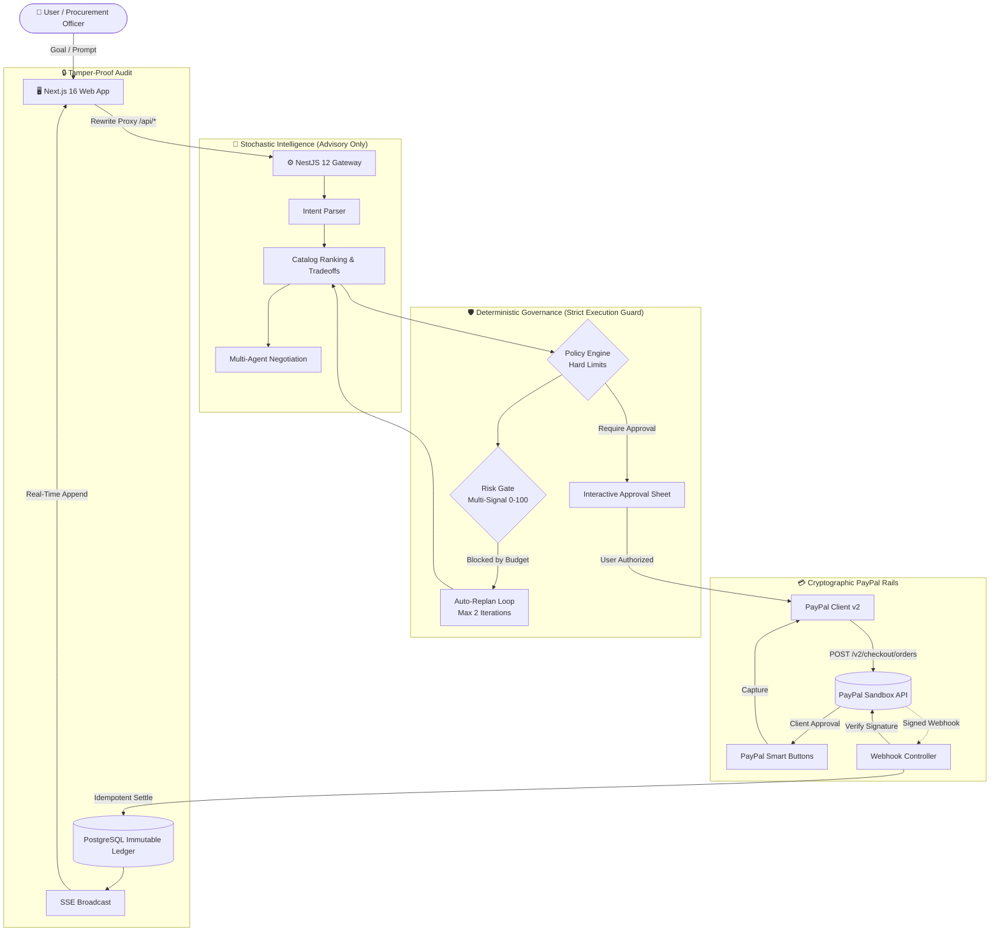

# PayPilot ⚡

> **Autonomous, Policy-Governed Commerce Agent with Cryptographic PayPal Settlement**  
> *Built for the PayPal AI Hackathon (Devpost)*

[](https://www.typescriptlang.org/)
[](https://nextjs.org/)
[](https://react.dev/)
[](https://nestjs.com/)
[](https://developer.paypal.com/)
[](https://opensource.org/licenses/MIT)

---

## 📸 Screenshots & Cockpit Previews

| Command Center & Live Agent Stepper | Interactive Governance Approval Sheet |
|---|---|
|  |  |

| Multi-Agent Autonomous Negotiation | Verifiable Trust Timeline |
|---|---|
|  |  |

---

## 🎯 Problem & Solution

### The Problem
Autonomous AI agents are transitioning from conversation to real-world tool execution. However, when AI agents interact with financial rails, existing prototypes either:
1. **Rely on Fragile Prompts**: Asking an LLM *"Is this safe to buy?"*, which is easily bypassed through prompt injection.
2. **Grant Unbounded Financial Authority**: Giving agents direct API credentials with no deterministic spending caps, risking runaway loops.
3. **Lack Verifiable Auditability**: Storing payment records without immutable transaction ledgers or cryptographic proof of settlement.

### The Solution: PayPilot
PayPilot enforces a strict architectural boundary between **stochastic generative intelligence** and **deterministic financial execution**:

$$\text{\bf User Intent} \longrightarrow \text{\bf AI Planning} \longrightarrow \text{\bf Deterministic Policy Guard} \longrightarrow \text{\bf Human Authorization} \longrightarrow \text{\bf PayPal Orders v2} \longrightarrow \text{\bf Webhook Verification} \longrightarrow \text{\bf Immutable Ledger}$$

- The LLM **never touches credentials**, **never moves money**, and **cannot bypass policy limits**.
- Hard spending limits, velocity checks, and risk gates are pure TypeScript functions with **100% test coverage**.
- Payments only settle once **PayPal's cryptographic webhook signature** is received and verified.

---

## ✨ Key Features

1. **Autonomous Procurement Planning**: Converts freeform goals into structured, itemized `PurchasePlan` candidates with spec tradeoff explanations.
2. **Deterministic Policy Engine & Budget Guard**: Enforces per-transaction caps, daily/monthly budgets, currency matching (`USD`), and category routing.
3. **Autonomous Budget Re-Planning**: When a preferred item exceeds limits (e.g., $289 monitor against a $250 limit), the agent automatically identifies the best compliant substitution (e.g., PixelView 24" at $229.99), explaining exact trade-offs.
4. **Behavioral Risk Gate**: Multi-signal scoring engine (0–100) evaluating budget consumption, merchant trust, catalog scarcity, recent payment velocity, and basket size.
5. **Interactive Approval Sheet**: Mobile-friendly bottom drawer featuring a rule-by-rule policy compliance checklist, risk chip, and official `@paypal/react-paypal-js` Smart Buttons.
6. **Buyer ↔ Merchant Autonomous Negotiation**: Multi-round concession game between buyer and merchant agents. Enforces strict buyer ceilings and secret server-side merchant reserve floors.
7. **PayPal Orders v2 & Webhook Verification**: Idempotent order creation (`PayPal-Request-Id`), capture tracking, and authoritative signature verification via PayPal's REST API.
8. **Verifiable Trust Timeline**: Real-time event stream (`/api/timeline/stream`) tracking every decision node with inspectable raw JSON evidence.
9. **Dual Operation Modes**: Connects live to PayPal Sandbox, with a deterministic zero-key `DEMO_MODE=true` offline fallback and webhook simulator.

---

## 🏗️ System Architecture



---

## 🛠️ Technology Stack

| Component | Technology | Rationale |
|---|---|---|
| **Frontend** | Next.js 16 (App Router), React 19, Tailwind CSS v4 | Server Components, Proxy route protection, zero-CORS rewrites |
| **UI Primitives** | Radix UI, Framer Motion, Lucide Icons, Sonner | Premium dark navy theme, smooth physics, accessible keyboard controls |
| **Data Grids & Charts** | AG Grid Community v36, Recharts | High-performance sortable transaction ledgers and spend charts |
| **Backend Gateway** | NestJS 12, TypeScript (ESM) | Modular micro-architecture, dependency injection, strict validation |
| **Database & ORM** | PostgreSQL 16+, Prisma 7, `@prisma/adapter-pg` | Relational consistency, double-entry ledgers, unique event constraints |
| **Authentication** | Better Auth | Secure session cookies, route protection, 1-Click Demo login |
| **Payment Rails** | PayPal Orders v2 REST API + Webhooks | Idempotent order creation, Smart Buttons, cryptographic verification |
| **Validation & Testing** | Zod 4, Vitest 4, Playwright | End-to-end schema validation, 402 passing unit tests, smoke tests |

---

## 💳 How PayPal is Used

PayPilot implements the modern PayPal Orders v2 and Webhooks architecture:

1. **Idempotent Order Creation (`POST /v2/checkout/orders`)**:
   - Initiated only after a `PurchasePlan` transitions to `APPROVED` and re-verifies policy constraints.
   - Generates structured `purchase_units` with full itemized breakdown (subtotal, tax, shipping, discount, item descriptions).
   - Transmits a unique `PayPal-Request-Id` derived from `hash(planId + approvalId)` to guarantee zero duplicate charges on network retries.
2. **Client-Side Authorization (`@paypal/react-paypal-js`)**:
   - PayPal Smart Buttons render dynamically inside the Approval Sheet once the user signs off on the policy checklist.
3. **Capture Execution (`POST /v2/checkout/orders/{id}/capture`)**:
   - Validates that the captured PayPal order ID matches the pending internal payment record. Transitions payment to `CAPTURE_PENDING`.
4. **Cryptographic Webhook Settlement (`POST /webhooks/paypal`)**:
   - PayPilot treats PayPal Webhooks as the **sole authoritative settlement trigger**.
   - Validates webhook authenticity using PayPal's `/v1/notifications/verify-webhook-signature` endpoint.
   - Dedupes incoming `event.id` values against a unique database table to safely ignore duplicate transmissions.

---

## 🤖 How AI is Used

PayPilot explicitly isolates generative intelligence to advisory roles:

1. **Intent Parsing**: Converts ambiguous natural language into structured JSON constraints (category, budget ceilings, priority weights).
2. **Catalog Tradeoff Generation**: Compares primary candidates against alternatives, extracting spec trade-offs (e.g., *"- $59.01, 24\" QHD instead of 27\" 4K"*).
3. **Multi-Agent Negotiation**: Simulates dynamic price discovery between a Buyer Agent and a Merchant Agent. The code enforces unbreachable buyer ceilings and secret merchant reserve floors, falling back to deterministic concession rules if LLM output exceeds bounds.

---

## 🔒 Security Model

- **Prompt Injection Immunity**: Governance policies (`maxTransactionAmount`, `dailySpendingLimit`) are stored in PostgreSQL and evaluated by pure TypeScript functions. An LLM prompt cannot alter spending limits.
- **Server-Side Floor Confidentiality**: The merchant's break-even reserve price is strictly isolated on the server and never sent to the buyer LLM or client bundle.
- **Secret Isolation**: PayPal Client Secrets and Better Auth keys are never exposed to the frontend. All client API communication passes through Next.js server rewrites.
- **Replay Protection**: Webhook event IDs are constrained by unique database indexes. Replayed events return HTTP 200 without executing secondary ledger mutations.

---

## 🚀 Quick Start Guide

### Prerequisites
- **Node.js**: v20+ (Node.js 24 recommended)
- **Package Manager**: `pnpm` (`npm install -g pnpm`)
- **Docker**: For running local PostgreSQL (`docker compose up -d`)

### 1. Clone & Configure Environment
```bash
git clone https://github.com/your-username/paypilot.git
cd paypilot

# Copy root environment template
cp .env.example .env
```

### 2. Install Dependencies
```bash
pnpm install
```

### 3. Start Database & Seed Catalog
```bash
# Start local PostgreSQL container
pnpm db:up

# Run Prisma database migrations
pnpm db:migrate

# Seed 17 fictional catalog items and initial test users
pnpm db:seed
```

### 4. Run Development Servers
```bash
# Starts both NestJS API (port 4000) and Next.js Web (port 3000)
pnpm dev
```
Open **`http://localhost:3000`** in your browser.

---

## 🎮 Demo Credentials & Quick Test

PayPilot includes pre-seeded demo accounts with active policies:

| Account | Email | Password | Role |
|---|---|---|---|
| **Demo User** | `demo@paypilot.dev` | `Password123!` | Standard procurement user ($250 cap, Ask Every Time) |
| **Tester User** | `tester@paypilot.ai` | `Password123!` | Historical user with prior transactions & captured ledger |

> **Tip**: Click the prominent **"Continue as Demo User"** button on the `/welcome` or `/login` screen for 1-click sign-in without typing credentials.

---

## 🌐 PayPal Sandbox Setup & Webhooks

For live testing with real PayPal Sandbox accounts, follow our detailed guide:
👉 **[Read docs/PAYPAL_SETUP.md](file:///home/nulltrace/Documents/Projects/PayPal%20Hackathon/PayPilot/docs/PAYPAL_SETUP.md)**

### Running Without PayPal Keys (`DEMO_MODE=true`)
If you don't have PayPal developer credentials handy, leave `DEMO_MODE=true` in `.env`. PayPilot will:
1. Provide mock PayPal orders and mock capture IDs.
2. Activate the **Dev Webhook Simulator** on `/payments/[id]`, allowing you to simulate `COMPLETED`, `DENIED`, `REVERSED`, and duplicate webhook events directly from the UI.

---

## 🧪 Running the Test Suite

```bash
# Run all 402 unit & state machine tests across packages
pnpm test

# Run strict TypeScript typecheck (0 errors, no 'any')
pnpm typecheck

# Run lint checks
pnpm lint

# Run Playwright end-to-end smoke test (Chromium + Mobile 390px)
cd apps/web && npx playwright test
```

---

## 📁 Project Structure

```
paypilot/
├── apps/
│   ├── api/                    # NestJS 12 Gateway
│   │   ├── src/
│   │   │   ├── agent/          # Procurement planning & catalog ranking
│   │   │   ├── policy/         # Pure deterministic policy & risk gate
│   │   │   ├── replan/         # Autonomous budget re-planning engine
│   │   │   ├── negotiation/    # Multi-agent bargaining protocol
│   │   │   ├── paypal/         # PayPal Orders v2 REST client
│   │   │   ├── payments/       # Payment state machine & capture
│   │   │   ├── webhooks/       # Cryptographic webhook signature verifier
│   │   │   └── timeline/       # SSE streaming audit ledger
│   │   └── prisma/             # Schema, migrations, and product seed data
│   │
│   └── web/                    # Next.js 16 Frontend (React 19)
│       ├── src/
│       │   ├── app/            # App Router pages (9 screens)
│       │   ├── components/     # UI primitives, live agent panel, approval sheet
│       │   ├── hooks/          # useEventStream (SSE connection)
│       │   ├── lib/            # Typed API client, Zod schemas, Better Auth
│       │   └── proxy.ts        # Next 16 route protection proxy
│       └── tests/              # Playwright desktop and mobile smoke tests
│
├── docs/                       # Architecture, Security, API, and PayPal setup docs
├── postman/                    # Postman collection & sandbox environment
├── docker-compose.yml          # Local PostgreSQL container definition
└── render.yaml                 # Production deployment blueprint
```

---

## ⚠️ Limitations & Future Work

PayPilot was built as an exploration of autonomous agent governance for the PayPal AI Hackathon:
- **Sandbox Only**: Built and validated strictly against PayPal Sandbox. It is **not** audited or certified for unmonitored production money movement.
- **Simulated Catalog**: Products are currently sourced from an internal seeded catalog rather than live third-party merchant APIs.
- **Single-Merchant Carts**: Multi-item plans currently assume fulfillment through a single merchant checkout session. Future work includes multi-merchant split orders and automated recurring subscription renegotiation.

---

## 📄 License
This project is open-source under the [MIT License](LICENSE).
