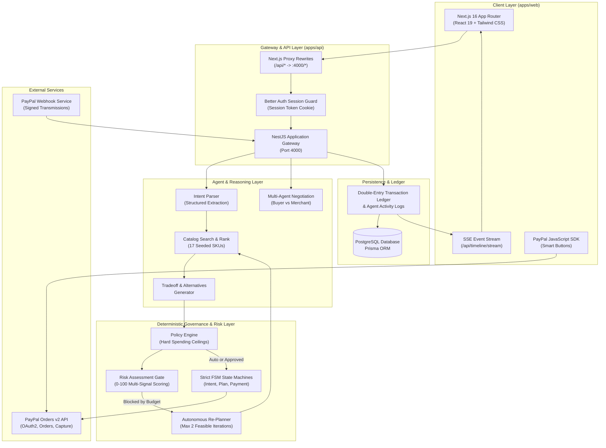
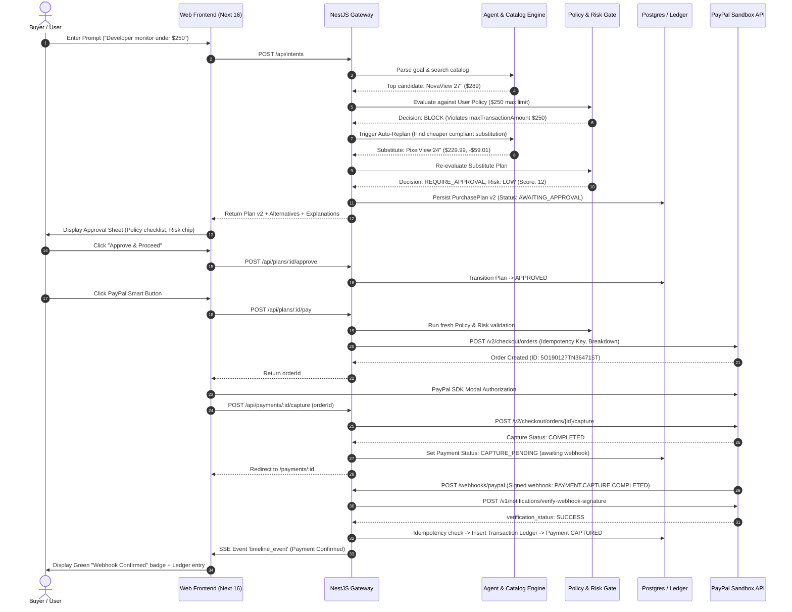
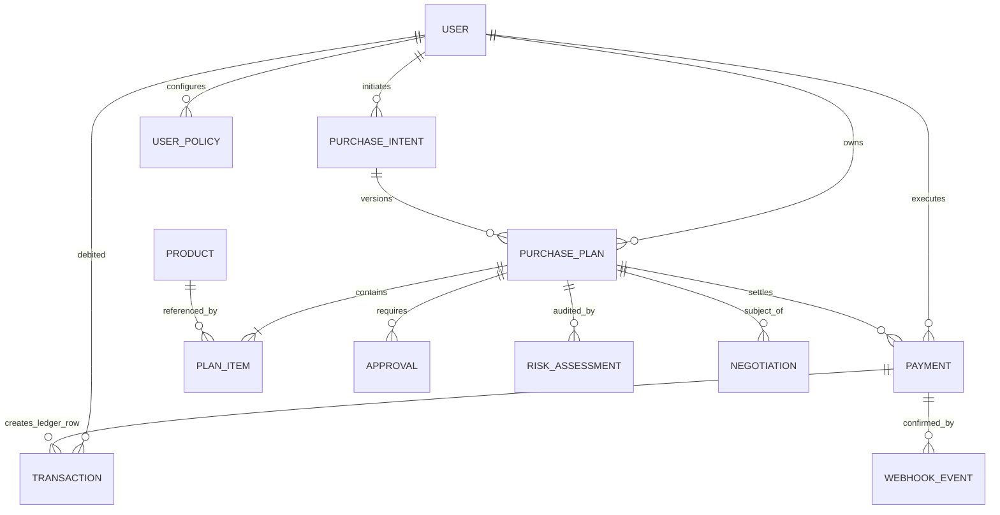

# PayPilot System Architecture

PayPilot is an autonomous, policy-governed commerce agent architecture engineered to bridge natural-language procurement intents with verified, cryptographic PayPal payment execution.

---

## 1. High-Level System Architecture

PayPilot enforces strict separation between **stochastic generative intelligence** (LLMs for intent parsing, catalog summarization, and negotiation dialogue) and **deterministic financial governance** (spending limits, policy enforcement, multi-factor risk scoring, state machines, and cryptographic PayPal webhooks).

---

## 2. End-to-End Execution Flow

The sequence diagram below illustrates the exact lifecycle of a user request—from freeform intent to final settlement:

---

## 3. Core Subsystems

### 3.1 Procurement & Reasoning Agent (`apps/api/src/agent`, `src/intents`)
- **Intent Extraction**: Evaluates natural language prompts to detect target categories (`Electronics`, `Accessories`, `Home`, `Lifestyle`, `Work`), upper budget constraints, feature keywords, and urgency.
- **Product Matching**: Executes deterministic, ranked queries across active catalog items, prioritizing value, rating, and stock availability.
- **Tradeoff Analysis**: Generates fact-based comparisons highlighting spec differences (e.g., panel size, resolution, refresh rate) against alternative products.

### 3.2 Deterministic Governance Layer (`apps/api/src/policy`)
- **Zero-Hallucination Policy Engine**: Written as pure, side-effect-free TypeScript functions with 100% test coverage.
- **Rules Enforced**:
  1. **Currency Matching**: Strict verification that cart and policy currencies align (`USD`).
  2. **Transaction Ceilings**: Cart total $\le$ `maxTransactionAmount`.
  3. **Velocity & Spend Caps**: Running sum of captured transactions in current day and calendar month against `dailySpendingLimit` and `monthlySpendingLimit`.
  4. **Category Routing**: Instant rejection of `blockedCategories`; verification of `allowedCategories`.
  5. **Autonomy Modes**:
     - `MANUAL_APPROVAL`: Always requires human sign-off.
     - `ASK_EVERY_TIME`: Default safe mode. Every purchase requires interactive approval.
     - `AUTO_WITHIN_LIMITS`: Allows zero-click auto-authorization only if amount $\le$ `requireApprovalAbove` and category is listed in `autoApproveCategories`.

### 3.3 Behavioral Risk Gate (`apps/api/src/policy/risk.gate.ts`)
Calculates an objective risk score ($0 - 100$) by combining weighted signals:
- Price variance against historical user spend.
- Proportion of daily budget consumed by single transaction ($>50\% \rightarrow +20$).
- Merchant trustworthiness and catalog stock levels ($<5 \rightarrow +15$).
- Rapid velocity ($>2$ payments within trailing 10 minutes).
- Negotiation volatility (deals involving concessions).
- Large basket size ($quantity > 3$).
- Scoring outcomes:
  - `LOW` ($0 - 25$): Auto-executable if policy permits.
  - `MEDIUM` ($26 - 50$): Normal interactive approval.
  - `HIGH` ($51 - 75$): Forces human approval regardless of autonomy mode.
  - `CRITICAL` ($76 - 100$): Mandatory hard block.

### 3.4 Multi-Agent Negotiation Protocol (`apps/api/src/negotiation`)
- **Buyer Agent**: Given an upper price ceiling determined by the user's remaining policy budget. Cannot propose offers exceeding this ceiling or under 50% of catalog list price.
- **Merchant Agent**: Enforces an unbreachable merchant floor (`product.minPrice`), preserved securely on the server and never revealed to the buyer agent or in client payloads.
- **Deterministic Guardrails**: If LLM output fails monotonicity or boundary checks, concession algorithms fall back to fixed mathematical concessions ($25\%$ split), preventing deadlocks.

### 3.5 PayPal Integration (`apps/api/src/paypal`, `src/payments`, `src/webhooks`)
- **Orders v2 REST API**: Standardized payload generation with full itemized breakdown (subtotal, tax, shipping, discount, item lists, invoice IDs).
- **Idempotency Protection**: Every API call transmits a unique `PayPal-Request-Id` derived from `hash(planId + approvalId)`.
- **Cryptographic Signature Verification**: Webhooks are validated using PayPal's `/v1/notifications/verify-webhook-signature` endpoint with the registered `PAYPAL_WEBHOOK_ID`.
- **Deduplication Engine**: Webhook event IDs are stored with unique constraints; duplicates are acknowledged with HTTP 200 and logged as `WEBHOOK_DUPLICATE_IGNORED`.

---

## 4. Database Schema Overview

---

## 5. Reliability & Fault Tolerance

1. **State Machine Concurrency**: All state transitions (`PlanStatus`, `PaymentStatus`, `NegotiationStatus`) are managed through finite state machines with valid transition matrices, preventing race conditions.
2. **Crash Resilience**: Better Auth session tokens and double-entry transaction records persist state across pod and server restarts.
3. **Graceful Degraded Mode (`DEMO_MODE=true`)**: If external PayPal Sandbox endpoints or LLM API keys experience rate limits, PayPilot gracefully falls back to deterministic rule-based concessions and internal sandbox simulation endpoints.

